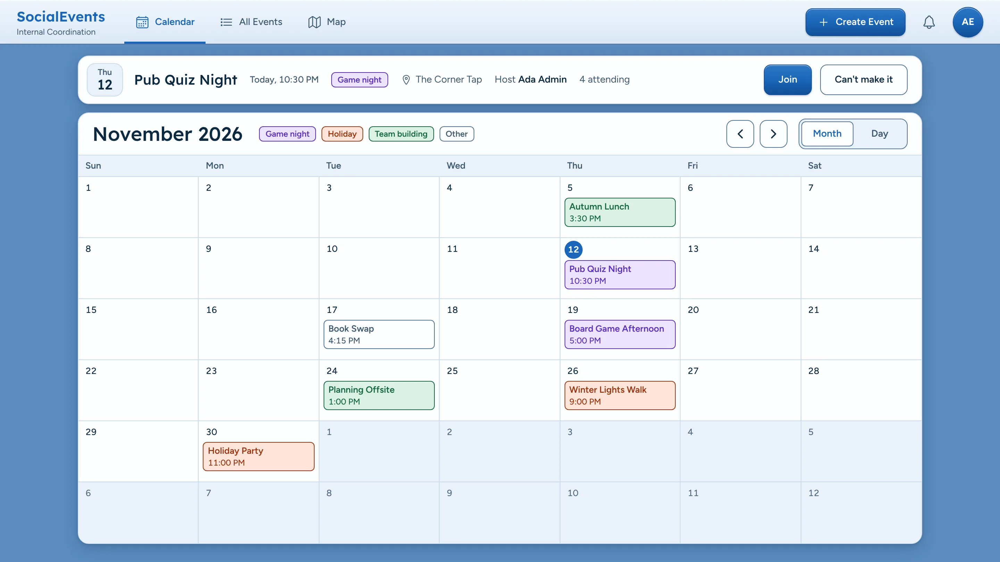
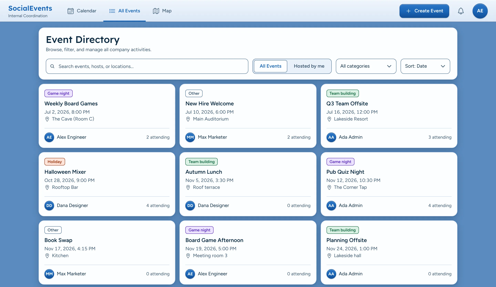
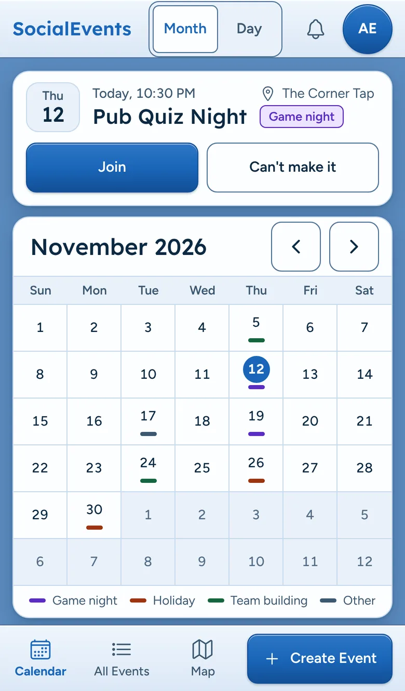
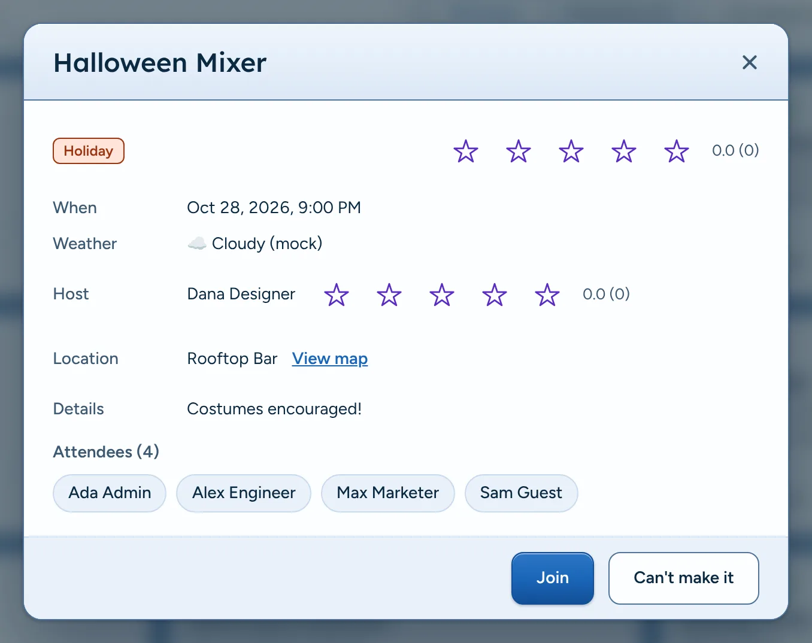
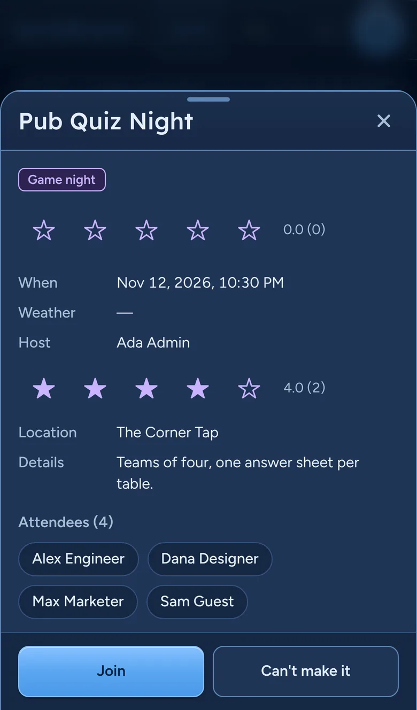
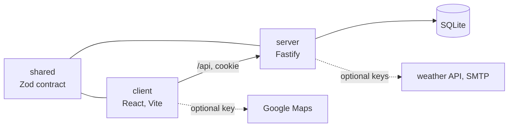

# SocialEvents

A planner for a company's social events. Anyone signed in can create an event, invite people or whole departments, and see everything on a calendar, a list or a map, with the weather at each place.

<p align="center">
  
</p>

**Status:** Personal project. Version 1 was built and checked on 2026-06-25. The redesign of 2026-11-13, "The open invitation", gave it the current look, with a light and a dark theme. All 19 briefs are done. It runs locally and is not deployed. It is a ground-up rebuild of a 2023 Next.js, Express and MongoDB app, whose spec is kept in [corpus/sources/SPEC.md](corpus/sources/SPEC.md).

## What it does

- People belong to departments. An event has a name, a time, a category, a place and a description, and its host invites single people or whole departments.
- Invitees get an email and a notification in the app, and answer Join or Can't make it. Tonight's event, or the next one, sits on top of the calendar as a ticket with both answers.
- Events show on a month or day calendar, in a directory you can search and filter by category, and on a map.
- Each event shows the weather at its place, and people rate both the event and its host from one to five stars.
- Admins create departments and move people between them.
- Light, Dark or System theme, picked in the profile dialog. On a phone the places move to a bottom bar and an event opens as a sheet.

A shared office calendar can hold the dates. This adds department-wide invites, the Join answers, the weather and the ratings, and keeps it all in one SQLite file. It is an internal tool. Every screen past the sign-in page needs an account, and it sells no tickets and publishes nothing to the outside.

## Screenshots

<table>
<tr>
<td width="62%" valign="top"></td>
<td width="38%" valign="top"></td>
</tr>
<tr>
<td width="62%" valign="top"></td>
<td width="38%" valign="top"></td>
</tr>
</table>

It runs with no API keys. Weather, maps and email fall back to built-in stand-ins, so the weather above reads "(mock)" and the map shows the places as a list. Keys in `server/.env` and `client/.env` turn on the real services.

## How it works

Three npm workspaces. `shared` holds the Zod schemas and types that are the API contract. `server` is a Fastify API on one SQLite file, grouped by feature, with hand-written queries and its own JWT sign-in in a cookie. `client` is a React page built with Vite, Tailwind, Base UI and TanStack Query and Router.



More in the wiki: [architecture](corpus/wiki/architecture.md), [data model](corpus/wiki/data-model.md), [API](corpus/wiki/api-contract.md), [sign-in](corpus/wiki/auth.md) and [design system](corpus/wiki/design-system.md).

## Run it locally

Requires Node 20.11 or newer.

```bash
npm install
npm run build:shared     # build the shared contract first
npm run migrate          # create the SQLite schema
npm run seed             # five people in three departments, four events
npm run dev:server       # Fastify on :3001
npm run dev:client       # second terminal: Vite on http://localhost:5173, forwarding /api to :3001
```

The seed prints the accounts it made. `npm run check` runs the typecheck, lint, format check, convention checks and tests. Settings, the optional keys, the browser specs and a single-port production run: [docs/getting-started.md](docs/getting-started.md).

## Project layout

| Path | What lives there |
|---|---|
| `shared/` | The API contract: Zod schemas and types |
| `server/` | Fastify API, one folder per feature: SQLite migrations and stores, sign-in, the weather and email adapters, the seed and the Vitest tests |
| `client/` | The React page, its Base UI wrappers and its jsdom tests |
| `playwright/` | The browser specs and how to start a seeded test server for them |
| `scripts/` | The contrast check and the changed-files lint that `npm run check` and `check:fast` call |
| `corpus/` | The project wiki: decisions, design system, status, briefs, the source spec and the Stitch design, and the UI test plans |

## Docs

- [docs/](docs/README.md): setup and how the images were made
- Project wiki: [corpus/](corpus/index.md), starting with [overview.md](corpus/wiki/overview.md)

## License

MIT, see [LICENSE](LICENSE).
